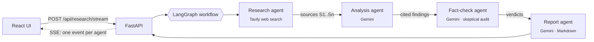

# ResearchPilot AI

**A multi-agent research assistant that turns a question into a source-cited, fact-checked report.**

Four specialist AI agents work in sequence: one searches the web, one analyzes the evidence, one skeptically audits that analysis against the sources, and one writes the final report. Every factual claim is tied back to a retrieved source (`[S1]`, `[S2]`, …), so the reader can verify it instead of taking the model's word for it.


---

## The problem

Asking a single LLM a research question gives you a fluent answer with no way to tell which parts are grounded and which are invented. ResearchPilot treats research as a **pipeline with separation of duties**, the way a human research team would, so that gathering evidence, interpreting it, challenging it and writing it up are distinct, inspectable steps.

## How it works



| Agent | Responsibility | Guardrail |
|---|---|---|
| **Research** | Runs an advanced Tavily web search and assigns each result a stable ID (`S1`…`Sn`). | Fails loudly if no sources come back instead of letting later agents guess. |
| **Analysis** | Synthesizes findings, patterns, disagreements and evidence gaps. | May use **only** the retrieved extracts; every factual point must cite a source ID. |
| **Fact-check** | Audits the analysis and labels each claim **SUPPORTED**, **PARTIALLY SUPPORTED** or **NOT ESTABLISHED**. | Forbidden from using outside knowledge; flags contradictions and overclaims. |
| **Report** | Writes an executive summary, key findings, limitations and conclusion. | Cannot introduce claims absent from the analysis; must make uncertainty explicit and link only to real retrieved URLs. |

Progress is streamed to the browser with **Server-Sent Events**: the UI shows Search → Analyze → Fact-check → Write lighting up as each agent finishes, with sources, analysis and fact-check output appearing before the final report is written.

The UI shows the final report **and** lets you expand the raw analysis and fact-check outputs, so the reasoning chain is transparent rather than hidden.

## Engineering decisions

- **Orchestration as a typed state graph.** The workflow is a LangGraph `StateGraph` over a `TypedDict` state (`question → sources → analysis → fact_check → report`). Each agent is a function that reads state and returns only the keys it owns, which keeps agents independently testable and makes it easy to add branches (e.g. a retry loop when the fact-checker rejects too many claims).
- **Grounding over fluency.** Sources are carried through state with IDs, and every downstream prompt is constrained to those sources. The list of links handed to the report agent is built from retrieved URLs, not generated by the model.
- **Adversarial review step.** A dedicated fact-checker with a deliberately skeptical role is there to catch overclaiming that a single-pass model would let through.
- **Honest failure modes.** If API keys are missing the API returns a clear `503` configuration error instead of pretending to research; upstream failures surface as `502` with context. Results always ship with a disclaimer that AI research must be verified.
- **Validated API boundary.** Pydantic models enforce question length (12–1000 chars) and a bounded `max_results` (3–10), so bad input is rejected before it costs an LLM call.
- **Streaming over blocking.** `POST /api/research/stream` runs the LangGraph workflow with `stream_mode="updates"` and emits an SSE event as each node starts and finishes, so a 30-second run feels like visible progress instead of a frozen spinner. The blocking `POST /api/research` endpoint is kept for scripts.
- **12-factor configuration.** Settings load from environment / `.env` via `pydantic-settings`: API keys, model name, allowed CORS origins on the backend, and the API URL on the frontend (`VITE_API_URL`). No secrets or hostnames are hardcoded.
- **Containerized backend** with a slim Python image, plus automated tests for health, input validation, SSE streaming and CORS config.

## Tech stack

| Layer | Technology |
|---|---|
| Agent orchestration | LangGraph |
| LLM | Google Gemini (`gemini-2.5-flash` by default, configurable) |
| Web retrieval | Tavily Search API |
| Backend API | FastAPI, Pydantic v2, Uvicorn |
| Frontend | React 18, TypeScript, Vite, react-markdown |
| Testing | pytest, FastAPI TestClient |
| Deployment | Docker (Render / Railway / Fly) + Vercel / Netlify for the frontend |

## Try it without API keys (demo mode)

Want to see the agents work before getting Gemini or Tavily keys? Demo mode replays a pre-recorded, source-cited sample run with the same streamed steps. Every question gets the same sample answer, and the UI labels it clearly.

**Frontend only, no backend at all:**
```bash
cd frontend
npm ci
VITE_DEMO_MODE=1 npm run dev
```
Open http://localhost:5173 and press **Start research**.

**Full stack, no keys** (exercises the real SSE endpoint):
```bash
cd backend && pip install -r requirements.txt && DEMO_MODE=1 uvicorn app.main:app --reload
cd frontend && npm ci && npm run dev    # second terminal
```

A static demo can be hosted for free: deploy `frontend/` to Vercel or Netlify with `VITE_DEMO_MODE=1` and no backend.

## Getting started

**Requirements:** Python 3.11+, Node 20+, a [Gemini API key](https://aistudio.google.com/apikey) and a [Tavily API key](https://tavily.com).

**1. Backend**
```bash
cd backend
cp .env.example .env          # then add your API keys
python -m venv .venv && source .venv/bin/activate
pip install -r requirements.txt
uvicorn app.main:app --reload
```
Interactive API docs: http://localhost:8000/docs

**2. Frontend** (in a second terminal)
```bash
cd frontend
cp .env.example .env          # optional: defaults to http://localhost:8000
npm ci
npm run dev
```
Open http://localhost:5173.

**Run with Docker (backend)**
```bash
cd backend
docker build -t researchpilot-api .
docker run --env-file .env -p 8000:8000 researchpilot-api
```

## Deploying

The backend and frontend deploy separately. Deploy the backend first so you have its URL.

**Backend (Render, Railway or Fly.io).** Point the service at the `backend/` folder and use the Dockerfile (it listens on `$PORT`, which these hosts set). Set these environment variables:

| Variable | Value |
|---|---|
| `GEMINI_API_KEY` | your Gemini key |
| `TAVILY_API_KEY` | your Tavily key |
| `CORS_ORIGINS` | your frontend URL, e.g. `https://researchpilot.vercel.app` (comma-separate several; no trailing slash) |
| `CORS_ORIGIN_REGEX` | optional, e.g. `https://researchpilot-.*\.vercel\.app` to allow Vercel preview deploys |
| `GEMINI_MODEL` | optional, defaults to `gemini-2.5-flash` |
| `DEMO_MODE` | optional, `1` serves the canned sample run with no keys |

Without Docker, use build command `pip install -r requirements.txt` and start command `uvicorn app.main:app --host 0.0.0.0 --port $PORT`. Check `https://<your-api>/health` returns `{"status":"ok"}`.

**Frontend (Vercel or Netlify).** Import the repo with root directory `frontend/`, framework preset Vite (build `npm run build`, output `dist`), and set:

| Variable | Value |
|---|---|
| `VITE_API_URL` | your backend URL, e.g. `https://researchpilot-api.onrender.com` |
| `VITE_DEMO_MODE` | optional, `1` runs the UI standalone with the sample run (no backend needed) |

`VITE_*` variables are baked in at build time, so redeploy the frontend after changing it. Then add the frontend's final URL to the backend's `CORS_ORIGINS`.

> Free tiers on Render sleep when idle, so the first request after a while can take ~30 s to wake the backend.

**Run the tests**
```bash
cd backend
pytest
```

## API

`POST /api/research/stream` takes the same body as below and returns `text/event-stream`:

```text
event: step
data: {"step": "research", "status": "running"}

event: step
data: {"step": "research", "status": "done", "output": {"sources": [...]}}

... analyze, fact_check, report ...

event: result
data: { same shape as POST /api/research }
```

On failure the stream ends with `event: error` and `data: {"step": "fact_check", "detail": "..."}`. Missing API keys still return a plain `503` before the stream starts.

`POST /api/research` (blocking)
```json
{ "question": "What are the latest practical uses of graph neural networks?", "max_results": 5 }
```

Response shape:
```json
{
  "question": "...",
  "report": "# Executive summary ... [S1] ...",
  "analysis": "...",
  "fact_check": "SUPPORTED: ... [S2]",
  "sources": [{ "id": "S1", "title": "...", "url": "https://...", "content": "..." }],
  "disclaimer": "AI-generated research can be incomplete or incorrect. ..."
}
```

`GET /health` → `{ "status": "ok", "service": "researchpilot-ai" }`

## Project structure

```text
.
├── backend/
│   ├── app/
│   │   ├── main.py        # FastAPI app, request validation, error handling
│   │   ├── agents.py      # LangGraph workflow and the four agents
│   │   ├── demo.py        # Keyless demo mode (replays demo_data.json)
│   │   └── config.py      # Environment-based settings
│   ├── tests/test_api.py
│   ├── Dockerfile
│   ├── requirements.txt
│   └── .env.example
└── frontend/
    ├── src/
    │   ├── App.tsx        # Research form, live agent pipeline, report view, sources
    │   ├── api.ts         # API URL from VITE_API_URL, SSE stream reader
    │   ├── demo/          # In-browser demo mode (VITE_DEMO_MODE)
    │   ├── main.tsx
    │   └── style.css
    ├── .env.example
    ├── package-lock.json
    ├── index.html
    └── vite.config.ts
```

## Limitations

- Fact-checking is **source-grounded**, not a guarantee of truth: it checks claims against what was retrieved, and retrieved sources can themselves be wrong.
- Agents run one after another, so a request takes as long as all four combined (progress is streamed, but the total time is the same).
- There is no persistence or authentication yet.

## Roadmap

- [x] Stream agent progress to the UI (Server-Sent Events) instead of a single blocking request
- [ ] Conditional LangGraph edge: re-research when the fact-checker marks too many claims NOT ESTABLISHED
- [ ] PostgreSQL persistence for research runs, with pgvector for semantic retrieval and source deduplication
- [ ] Background jobs, retries and rate limiting
- [ ] Evaluation suite measuring citation precision, claim support and answer completeness on a fixed question set
- [ ] Authentication and observability
- [ ] A live hosted demo (deployment config is ready, see [Deploying](#deploying))

Benchmarks will be added only once they are measured on a fixed evaluation set — no invented numbers.

## License

[MIT](LICENSE)
